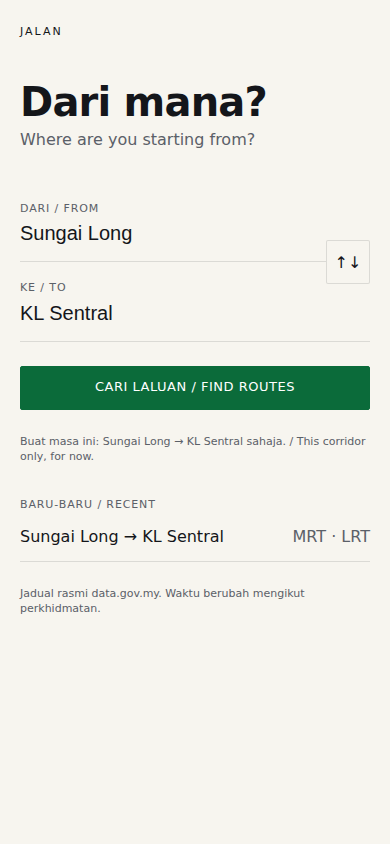
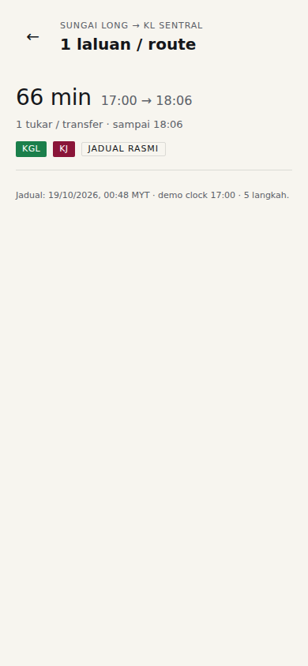
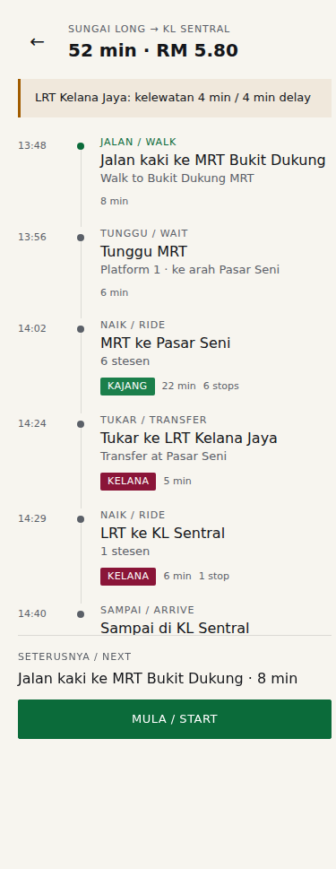

# jalan

A transit app for Malaysia — *how do I get from here to there, and what do I do next.*

Built as the first consumer of [`keystone`](https://github.com/zelton02/keystone), the design-system engine. The point of
this repo is not the feature set; it is proving that a written aesthetic contract survives
contact with a real screen.

## The stance

> **Signage, not a brochure.**

A transit app is read standing up, in the sun, in the rain, with one hand, while a bus is
arriving. It should behave like a good signboard: high contrast, pictogram-first, bilingual,
legible at a glance — not like a travel magazine.

That stance produces the rules in [`AESTHETIC.md`](./AESTHETIC.md). Read it before touching UI.

## Screens

| Search | Results | Journey |
| --- | --- | --- |
|  |  |  |

## Search

Both fields are search-as-you-type. Stops come from the local GTFS index and appear instantly.
Place suggestions come from Google Places API (New) when `GOOGLE_MAPS_API_KEY` is set — the
legacy Maps APIs are not enabled on the key — and fall back to Nominatim otherwise. Picking a stop
sends its coordinates; picking a place resolves its `place_id` to coordinates through
`/api/place`. Either way "Bandar Utama" routes from the station or the mall, not from the suburb
centroid. Distances use the last "use my location" or the other field as the reference point.

## Map

The journey screen draws the route on a Leaflet map with OpenStreetMap raster tiles (attribution
required, light personal use).

- Ride legs use GTFS `shapes.txt`, sliced between the boarding and alighting stops. Each stop is
  anchored to the nearest shape point with a forward-only search so loop services do not fold
  back; a stop more than 300 m off the shape means the feed's geometry skips that detour, and the
  leg is drawn as a faded straight line instead. Slices are downsampled to 300 points.
- Walk and transfer legs use the OSRM footpath geometry, requested once per leg at response time
  and cached by coordinate pair.
- Live vehicles on the plan's routes are blue dots, refreshed every 20 s from `/api/vehicles`.
- Tapping a step in the itinerary zooms the map to that leg; tapping it again returns to the
  whole journey.
- The results screen shows a compact, non-interactive preview map per route.

## Data pipeline

The app runs on Malaysia's official GTFS feeds, not mock data.

```bash
npm run ingest                                  # download 3 feeds -> data/jalan.db
npm run next -- --stop KG31 --dir north         # next MRT at Bukit Dukung
npm run next -- --feed ktmb --stop Kajang --at 08:00
npm run next -- --stop KG31 --dir north --json  # machine-readable
npm run route -- --from 3.0417,101.8014 --to 3.1344,101.6863 --at 08:00
npm run route -- --from 3.0417,101.8014 --to 3.1344,101.6863 --date 2026-10-21 --at 07:00
npm run live -- --route U5900                     # live vehicles + inferred delay
npm run board -- --q UTAR                         # find stops
npm run board -- --stop "bus|1004189"             # next departures at a stop
npm run punctual -- --route U5900                 # median delay by hour from history
```

The router (round-based RAPTOR over precomputed patterns) plans any A→B point. `npm run ingest`
rebuilds the `patterns` / `pattern_trips` tables in the same atomic swap as the raw GTFS tables.

See [`DATA.md`](./DATA.md) for sources, refresh cadence, and the known limitations
(frequency-based rail feed, no official delay feed, dirty fields).

## Run

Clone both repos side by side — the token/lint scripts expect `../keystone`:

```bash
git clone https://github.com/zelton02/keystone
git clone https://github.com/zelton02/jalan
cd jalan
npm install
npm run tokens   # regenerate src/styles/tokens.css from design/theme.json
npm run dev
npm run audit    # token drift check
npm run build
npm run deploy   # build + rsync dist/ to /var/www/jalan (production)
npm run walk:build  # rebuild the OSRM foot graph and restart osrm-foot
```

## Deploy

Production is `https://zhng.tech`: Caddy serves `/var/www/jalan` and proxies `/api/*` to the
Node API on `127.0.0.1:8795`. The domain is proxied through Cloudflare, so Caddy obtains its
Let's Encrypt certificate over HTTP-01 (the TLS-ALPN challenge never reaches this machine).

```bash
npm run deploy
```

The Caddyfile lives in [`deploy/Caddyfile`](./deploy/Caddyfile). Copy it to `/etc/caddy/Caddyfile`
and run `systemctl reload caddy` after editing. HTTPS also matters for the app itself: browsers
only allow `navigator.geolocation` in a secure context, so “Use my location” works on
`https://zhng.tech` and fails on a plain `http://` IP.

## Walking

The first and last mile uses a self-hosted OSRM foot graph (OpenStreetMap), not a straight line:

```bash
npm run walk:build   # Malaysia extract -> Klang Valley -> osrm-foot on 127.0.0.1:5000
```

`ingest/walk.mjs` asks OSRM for two matrices per plan (origin→stops, destination→stops). If the
container is down or a pair is unroutable, the router falls back to straight-line × 1.3, so the
app keeps working without it.

Station access is separate: [`config/station-walks.json`](./config/station-walks.json) holds the
street-to-platform seconds for the big interchanges (KL Sentral 10 min, Bandar Tasik Selatan
7 min, …), the rail default, the transfer buffers and the boarding buffer. Edit the file and save
— the API re-reads it on the next plan (mtime check), no restart or deploy. Only KL Sentral is
calibrated; the rest are estimates, marked `"source": "guess"`.

## Data

Routes, stops, and times come from the official `data.gov.my` GTFS feeds (see
[`DATA.md`](./DATA.md)). Line colours approximate the real Klang Valley lines but are not
official brand assets. Fares are not published in GTFS, so the app does not show them.
